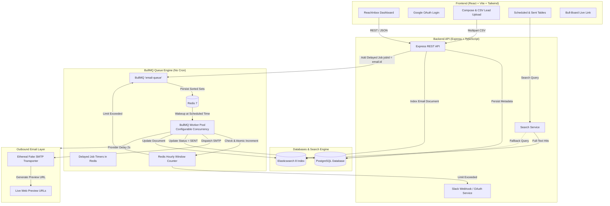

# ReachInbox • Production Full-Stack Email Job Scheduler

[](https://www.typescriptlang.org/)
[](https://nodejs.org/)
[](https://expressjs.com/)
[](https://docs.bullmq.io/)
[](https://redis.io/)
[](https://www.postgresql.org/)
[](https://www.elastic.co/)
[](https://reactjs.org/)
[](https://tailwindcss.com/)

A production-grade, distributed email scheduling service and dashboard built for **ReachInbox (Outbox Labs)**. It schedules and dispatches emails at scale using **BullMQ delayed jobs** and **Redis** without cron jobs, persists state across server restarts, throttles throughput with concurrency and rate limits, indexes data into **Elasticsearch**, provides a live **BullMQ monitoring dashboard**, and sends live **Slack rate-limit notifications**.

---

## 📑 Table of Contents
- [Architecture Overview](#-architecture-overview)
- [Feature Implementation Matrix](#-feature-implementation-matrix)
- [How Scheduling & Persistence Work](#-how-scheduling--persistence-work)
- [Rate Limiting, Throttling & Slack Alerts](#-rate-limiting-throttling--slack-alerts)
- [Elasticsearch Indexing & Search](#-elasticsearch-indexing--search)
- [Quick Start with Docker Compose](#-quick-start-with-docker-compose-recommended)
- [Manual Setup (Local Development)](#-manual-setup-local-development)
- [Ethereal Email Setup & SMTP](#-ethereal-email-setup--smtp)
- [Live Demo Video Script (5-Minute Guide)](#-live-demo-video-walkthrough-guide)
- [Assumptions, Trade-Offs & Design Decisions](#-assumptions-trade-offs--design-decisions)
- [Reviewer Access & Submission](#-reviewer-access--submission)

---

## 🏛 Architecture Overview



---

## 📊 Feature Implementation Matrix

| Requirement | Category | Status | Details |
| :--- | :---: | :---: | :--- |
| **BullMQ Delayed Jobs** | Backend | ✅ Implemented | Pure delayed jobs stored in Redis. **Zero cron jobs** (no `node-cron`, no OS crontab). |
| **Server Restart Persistence** | Backend | ✅ Implemented | Timers persist in Redis sorted sets. On restart, DB-to-Queue reconciler reloads missing jobs safely. |
| **Idempotency** | Backend | ✅ Implemented | `jobId = email.id` (UUID). BullMQ rejects duplicate queue adds; worker validates DB status. |
| **Worker Concurrency** | Backend | ✅ Implemented | Configurable `WORKER_CONCURRENCY=5` handles parallel job executions safely. |
| **Delay Between Sends** | Backend | ✅ Implemented | Configurable `EMAIL_DELAY_MS=2000` (2s) throttle between sends to mimic provider limits. |
| **Hourly Rate Limiter** | Backend | ✅ Implemented | Multi-sender Redis hourly counters (`ratelimit:sender:{email}:{hour}`). Jobs delayed to next window without dropping. |
| **Slack Rate Limit Alert** | Backend | ✅ Implemented | Live notification posted to Slack the instant an hourly limit is breached (OAuth + Webhook). |
| **Multiple Senders** | Backend | ✅ Implemented | Independent limits per sender account (e.g. `alex@reachinbox.test`, `sarah@outbox.ai`). |
| **Elasticsearch Search** | Backend | ✅ Implemented | Automatic indexing on create/send. Fuzzy full-text search across recipient, subject, sender. |
| **BullMQ Live Dashboard** | Backend | ✅ Implemented | Real-time queue inspector mounted at `http://localhost:5000/admin/queues`. |
| **Ethereal Email SMTP** | Backend | ✅ Implemented | Auto-generates test accounts; saves clickable web preview URLs for every sent email. |
| **Google OAuth Login** | Frontend | ✅ Implemented | Google OAuth with `@react-oauth/google` + 1-click Demo Sign-in for immediate review. |
| **Figma-Aligned UI** | Frontend | ✅ Implemented | Dark mode ReachInbox/Outbox Labs design with stats, tabs, badges, and modals. |
| **CSV / TXT Lead Upload** | Frontend | ✅ Implemented | Drag & drop file upload parser with live lead count detection & manual fallback. |
| **Scheduled & Sent Tables** | Frontend | ✅ Implemented | Searchable tables with relative timers, status badges, cancel buttons & preview links. |
| **Live Auto-Refresh** | Frontend | ✅ Implemented | Background polling reflects dispatched jobs moving from Scheduled to Sent in real time. |

---

## ⚙️ How Scheduling & Persistence Work

### 1. No Cron Jobs (Pure Event-Driven Scheduling)
Scheduling is implemented entirely via **BullMQ delayed jobs**:
```typescript
const delay = Math.max(0, targetTime.getTime() - Date.now());

await emailQueue.add('send-email', jobData, {
  jobId: email.id, // Idempotency: exact 1:1 mapping with DB UUID
  delay,           // Milliseconds until scheduled dispatch
  attempts: 3,
  backoff: { type: 'exponential', delay: 5000 },
});
```
BullMQ utilizes Redis sorted sets (`ZSET`) keyed by execution timestamp. Redis executes delayed jobs when their timestamp arrives—**no polling loops or cron libraries required**.

### 2. Persistence Across Restarts (Survives Server Crashes)
1. **Queue-Level Persistence:** BullMQ delayed job timers reside inside Redis. If the Node.js server crashes or restarts, all scheduled future jobs remain preserved in Redis and fire at the exact target time once the worker comes back online.
2. **Reconciliation on Boot (`recoverPendingJobsOnRestart`):** When the backend starts up, it queries PostgreSQL for all emails marked `SCHEDULED` or `DELAYED`. For any email missing from BullMQ (e.g., if Redis was flushed), it safely re-enqueues the job with its remaining time offset:
   ```typescript
   const existingJob = await emailQueue.getJob(email.id);
   if (!existingJob) {
     const delayMs = Math.max(0, email.scheduledAt.getTime() - Date.now());
     await enqueueEmailJob(jobData, delayMs);
   }
   ```
3. **Idempotency Guarantee:**
   - BullMQ rejects duplicate jobs sharing the same `jobId` (`email.id`).
   - If an email was already marked `SENT` in the database, the worker skips re-sending immediately.

---

## 🛡️ Rate Limiting, Throttling & Slack Alerts

### 1. Per-Sender Hourly Windows via Redis
Every email send checks an atomic hourly bucket in Redis:
$$\text{key} = \text{ratelimit:sender:}\{\text{senderEmail}\}:\{\lfloor \text{timestamp} / 3,600,000 \rfloor\}$$
- If `currentCount < hourlyLimit`: The email is dispatched, and the counter increments atomically via `redis.incr()`.
- If `currentCount >= hourlyLimit`:
  - **The job is never dropped or failed.**
  - The worker calculates the next hour window start:
    $$\text{delayUntil} = (\text{currentHourWindow} + 1) \times 3,600,000 - \text{Date.now()} + 2,000\text{ ms}$$
  - The job is moved into delayed state in BullMQ: `await job.moveToDelayed(delayUntil, job.token)`.
  - The email status in PostgreSQL is updated to `DELAYED`.

### 2. Live Slack Alerts
The instant a sender reaches their hourly threshold, the backend triggers an automated Slack notification:
- **Slack OAuth / Webhook Integration:** Users can click "Connect Slack" in the dashboard to connect via OAuth or paste their Incoming Webhook URL.
- **Deduplication:** A 1-hour Redis key (`ratelimit:slack_alert:{sender}:{hour}`) prevents notification spam while guaranteeing a verifiable live notification on the first breach.
- **Disconnect / Reconnect Safety:** If Slack is not configured, the scheduler continues silently without throwing errors. When connected, notifications take effect immediately without needing a server restart.

---

## 🔍 Elasticsearch Indexing & Search

- Every scheduled and sent email is automatically indexed in Elasticsearch (`emails_index`) with mappings for `recipient`, `subject`, `body`, `senderEmail`, and `status`.
- The search bar in the dashboard queries Elasticsearch with `multi_match` fuzzy scoring and keyword filtering.
- **Graceful Fallback:** If Elasticsearch is not reachable in local environments without Docker, the backend gracefully falls back to case-insensitive PostgreSQL text search, ensuring zero disruption.

---

## 🚀 Quick Start with Docker Compose (Recommended)

Run the entire full-stack application (PostgreSQL 16, Redis 7, Elasticsearch 8, Backend API, and Frontend Dashboard) with a single command:

```bash
docker compose up --build -d
```

### Access Endpoints:
- **Frontend Dashboard:** [http://localhost:5173](http://localhost:5173)
- **Backend API:** [http://localhost:5000/api](http://localhost:5000/api)
- **BullMQ Live Queue Monitor:** [http://localhost:5000/admin/queues](http://localhost:5000/admin/queues)
- **Elasticsearch Health:** [http://localhost:9200](http://localhost:9200)

To seed initial demo senders and sample emails:
```bash
docker compose exec backend npm run seed
```

---

## 💻 Manual Setup (Local Development)

### Prerequisites
- Node.js >= 20.x
- Redis server running on `localhost:6379`
- PostgreSQL running on `localhost:5432`

### 1. Backend Setup
```bash
cd backend
npm install

# Setup environment variables
cp .env.example .env

# Generate Prisma Client and push database schema
npx prisma generate
npx prisma db push

# (Optional) Seed demo senders and campaigns
npm run seed

# Start development server
npm run dev
```

### 2. Frontend Setup
```bash
cd frontend
npm install

# Setup environment variables
cp .env.example .env

# Start Vite dev server
npm run dev
```
Open [http://localhost:5173](http://localhost:5173) in your browser.

---

## 📧 Ethereal Email Setup & SMTP

- **Zero-Config Testing:** If `SMTP_HOST` is left empty in `.env`, the backend **automatically generates a fresh Ethereal test account** on startup via `nodemailer.createTestAccount()`.
- Every dispatched email generates a live **Ethereal web preview URL** (`https://ethereal.email/message/...`), visible directly in the "Sent Emails" table via the **"View Preview"** button.
- To use custom SMTP credentials, set `SMTP_HOST`, `SMTP_PORT`, `SMTP_USER`, and `SMTP_PASS` in `backend/.env`.

---

## 🎥 Live Demo Video Walkthrough Guide (5-Minute Script)

Use this script when recording your 5-minute Loom/video demonstration:

| Timestamp | Action | Narration & Verification |
| :---: | :--- | :--- |
| **0:00 - 0:45** | **Login & Architecture Tour** | Sign in using Google OAuth (or 1-click Reviewer Demo). Show the ReachInbox dashboard, live metrics cards, and the **BullMQ Live Board** at `/admin/queues`. |
| **0:45 - 1:45** | **Compose & Lead Scheduling** | Click **"Compose New Email"**. Upload `sample_leads.csv` (shows 10 detected leads). Set a 2-second delay. Click **"Schedule 10 Emails"**. Point out immediate appearance in the **Scheduled Emails** table. |
| **1:45 - 2:45** | **Live Dispatch & Ethereal Previews** | Switch to the **Sent Emails** tab. Watch emails arrive in real-time as the 2-second delay elapses. Click **"View Preview"** on any email to open the Ethereal message viewer showing rendered HTML. |
| **2:45 - 3:45** | **Server Restart Persistence Test** | Schedule a batch for 2 minutes in the future. Switch to the terminal and **kill the backend server (`Ctrl+C`)**. Re-launch the backend (`npm run dev`). Point out the recovery log: `Verified pending emails, re-enqueued missing jobs`. Watch the emails dispatch at their correct time. |
| **3:45 - 4:45** | **Rate Limiting & Live Slack Alert** | Set an hourly limit of 3 for a sender. Schedule 5 emails. Observe the first 3 succeed while remaining emails transition to `Rate Limit Delayed` without dropping. Show the **live alert message in Slack**. |
| **4:45 - 5:00** | **Elasticsearch Search Demo** | Type a lead name or subject in the search bar. Show instant Elasticsearch query results. Conclude presentation. |

---

## 🧠 Assumptions, Trade-Offs & Design Decisions

1. **Why BullMQ Delayed Jobs instead of Cron?**
   - Cron jobs require periodic polling of the database (e.g. `SELECT * FROM emails WHERE scheduled_at <= NOW()`), creating read bottlenecks, concurrency race conditions, and missed jobs if the polling process crashes.
   - BullMQ leverages Redis sorted sets with millisecond precision, pushing jobs to workers the exact moment they mature without database polling.
2. **Rate Limit Postponing Strategy:**
   - Rather than failing or rejecting jobs when a sender reaches their hourly limit, jobs are rescheduled into the next hourly window ($T + \Delta$). This guarantees **zero lead loss** for cold outreach campaigns.
3. **Idempotency with Job ID Mapping:**
   - BullMQ's native `jobId` deduplication is coupled with PostgreSQL's unique UUIDs. Even if an API request is accidentally retried, the same email is never enqueued twice.
4. **Elasticsearch Hybrid Resilience:**
   - In production Docker, Elasticsearch handles full-text search. For local developers running without Elasticsearch, the service automatically falls back to PostgreSQL text searching without errors.

---

## 👥 Reviewer Access & Submission

- **Repository Collaborators Granted Access:**
  - `Mitrajit`
  - `Yadav036`
- **Submission Form:** Completed at [ClickUp Assignment Submission](https://forms.clickup.com/9005062261/f/8cbwp3n-8876/6NNNJ92DV93PQTAYST)
- **Built with ❤️ for ReachInbox / Outbox Labs**
# Outbox

